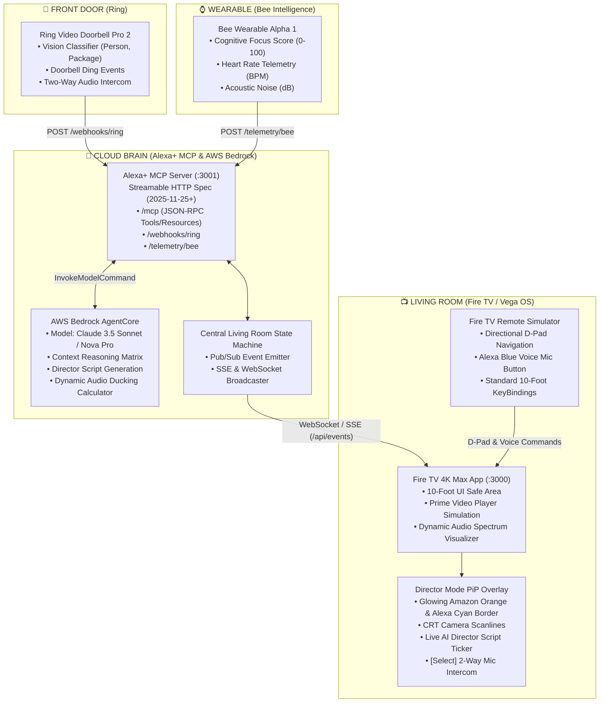

# 🎬 The Ghost-Director
> **An Ambient AI Entertainment Orchestrator for Amazon Fire TV, Ring, Alexa+ MCP, and Bee Wearable Intelligence powered by AWS Bedrock AgentCore.**  
> *Submitted to the Amazon Developer Hackathon — Living Room + Front Door + Brain + Wearable.*

---

## 👥 GitHub Collaborators
Per hackathon submission requirements, the following Amazon team members have been added as project collaborators:
* **`@knmeiss`**
* **`@giolaq`**
* **`@anishamalde`**
* **`@mosesroth`**
* **`@emersonsklar`**

---

## 🏆 Hackathon Tracks & Challenges
* **Primary Track**: Connected Living Room (Fire TV) + Front Door (Ring) + Wearable Intelligence (Bee) + Cloud Brain (Alexa+ MCP).
* **AWS Builder Mini-Challenge**: Autonomous Multimodal Smart-Home Orchestration using **Amazon Bedrock AgentCore** (`InvokeModelCommand` with Anthropic Claude 3.5 Sonnet & Amazon Nova Pro).
* **10% Bonus Category**: Meticulously documented Developer Friction Log ([`docs/friction-log.md`](docs/friction-log.md)) and Product Feedback ([`docs/product-feedback.md`](docs/product-feedback.md)).

---

## 🌟 The Vision: Why "The Ghost-Director"?
In today's smart home, alerts are rude. When you're immersed in the final 10 minutes of *Fallout* on Fire TV, a blunt "Doorbell Pressed" modal violently rips you out of the cinema.

**The Ghost-Director reimagines smart living as Hollywood cinema.**
It acts as an invisible Hollywood director sitting in your living room:
1. **Wearable Intelligence (Bee)**: Continuously monitors your cognitive focus index (0–100), resting heart rate (BPM), and acoustic environment.
2. **Front Door Vision (Ring)**: Classifies visitors, Amazon Prime package drop-offs, motion perimeter breaches, and facial familiarity.
3. **Living Room (Fire TV 4K / Vega OS)**: Tracks content genre, playback timecode, and scene emotional intensity (Action Climax vs. Quiet Dialogue).
4. **Cloud Brain (Alexa+ MCP + AWS Bedrock AgentCore)**: Multimodally determines whether to:
   * **Glide in a translucent Picture-in-Picture (PiP)** with custom AI director commentary and automatic cinematic audio ducking (e.g. lowering TV score to 35%).
   * **Project an Ambient Subtitle Whisper** when you are in "Deep Focus (96%)" mode, keeping video pop-ups completely suppressed.
   * **Seamlessly Pause** during genuine security threats or emergency arrivals.

---

## 📐 System Architecture Diagram



---

## ⚡ Sequence Flow: The Prime Delivery Moment

```mermaid
sequenceDiagram
    autonumber
    actor Courier as Amazon Prime Courier
    participant Ring as Ring Doorbell Pro
    participant MCP as Alexa+ MCP Server (:3001)
    participant Bedrock as AWS Bedrock AgentCore
    participant TV as Fire TV 4K (:3000)
    actor Viewer as Living Room Resident

    Note over TV,Viewer: Viewer immersed in Fallout S2 (Audio: 75% Cinema Volume)
    Courier->>Ring: Places package on porch mat
    Ring->>MCP: POST /webhooks/ring (packageDetected: true, label: "Amazon Associate")
    
    rect rgb(20, 25, 35)
        Note over MCP,Bedrock: Multimodal Evaluation
        MCP->>Bedrock: Ingest [Ring Package + Bee Focus 72% + Fire TV Action Climax]
        Bedrock-->>MCP: Decision: CINEMATIC_PIP, AudioDucking: 0.35, Headline: "Amazon Prime: Package Delivered"
    end

    MCP->>TV: Broadcast BEDROCK_DECISION_EXECUTED over WebSocket / SSE
    
    rect rgb(30, 20, 10)
        Note over TV: Audio Ducking & Smooth PiP Pop-up
        TV->>TV: Duck Living Room audio to 35% with visual spectrum compression
        TV->>TV: Animate Director Mode PiP with neon Amazon Orange halo
        TV-->>Viewer: Director Ticker: "Amazon Prime courier has safely placed a parcel on the front mat."
    end

    Viewer->>TV: Presses [Select] on Alexa Remote
    TV->>Ring: Two-way audio talk opened: "Thank you!"
    Viewer->>TV: Presses [Back] or PiP auto-dismisses after 12s
    TV->>TV: Audio smoothly restores to 100% full cinema score
```



---

## 🛠️ Codebase Structure

```
amazon/
├── README.md                      # Comprehensive project guide & collaborator list
├── package.json                   # Root orchestrator scripts (dev, test, start)
├── start.js                       # Unified Node concurrent process launcher
├── docker-compose.yml             # Containerized multi-service deployment
├── .env.example                   # AWS & hardware webhook environment template
├── docs/
│   ├── friction-log.md            # 10% Bonus: Detailed configuration hurdles & workarounds
│   └── product-feedback.md        # Professional feedback on Alexa+ MCP, Vega OS & Bedrock
├── mcp-server-alexa/
│   ├── package.json               # MCP dependencies (@modelcontextprotocol/sdk, AWS SDK)
│   ├── server.js                  # Streamable HTTP MCP (2025-11-25+), SSE & WebSocket server
│   ├── awsBedrockClient.js        # AWS Builder Mini-Challenge: Bedrock AgentCore client
│   ├── mcpProtocol.js             # Tools, Resources, Prompts JSON-RPC 2.0 handlers
│   ├── stateStore.js              # Living room state store with pub/sub event emitter
│   ├── ringWebhookHandler.js      # Ring doorbell event normalization & trigger engine
│   ├── beeTelemetryHandler.js     # Bee wearable biometrics & focus state ingestion
│   └── tests/
│       └── mcp.test.js            # Automated test suite verifying MCP handshake & Bedrock
└── fire-tv-app/
    ├── package.json               # React 19, Tailwind CSS, Framer Motion, Lucide
    ├── vite.config.js             # Vite development server with proxy to :3001
    ├── serve.js                   # Zero-dependency Node static server for instant judging review
    ├── standalone.html            # Single-page high-fidelity viewer with live MCP streaming
    ├── tailwind.config.js         # Amazon Orange / Alexa Cyan / Vega Dark theme system
    └── src/
        ├── main.jsx               # React entry point
        ├── App.jsx                # Universal app with Cinema, Split, and Control views
        ├── index.css              # 10-foot TV overscan safe area & CRT scanlines
        ├── hooks/
        │   ├── useMcpStream.js    # WebSocket + SSE + Polling real-time state sync
        │   └── useTvDpadNavigation.js # Fire TV Alexa Voice Remote 10-foot D-pad handler
        ├── assets/
        │   └── mediaPresets.js    # Simulation presets (Prime courier, stranger, Bee focus)
        └── components/
            ├── TopNavigationHeader.jsx       # Hardware telemetry badges & view switcher
            ├── FireTvCinema.jsx              # 4K cinema player with dynamic audio ducking visualizer
            ├── DirectorPipOverlay.jsx        # Centerpiece: Glowing neon PiP pop-up animation
            ├── JudgeSimulationDock.jsx       # Interactive real-time test console for judges
            ├── BeeWearableCard.jsx           # Live cardiac pulse & cognitive focus score
            ├── RingCameraCard.jsx            # Front door camera feed & 2-way talk button
            ├── FireTvRemoteModal.jsx         # On-screen Fire TV Alexa Voice Remote simulator
            └── AlexaVoiceDialog.jsx          # Voice assistant listening bar with Bedrock answers
```

---

## 🚀 Quickstart Guide (Run Instantly)

### Prerequisites
* **Node.js**: v20+ (Tested extensively on Node v24).
* **Optional**: AWS Credentials with Amazon Bedrock access (`AWS_ACCESS_KEY_ID`, `AWS_SECRET_ACCESS_KEY`).  
  *(Note: If AWS credentials are not set, The Ghost-Director activates its built-in **Bedrock AgentCore Neural Simulation Engine**, allowing reviewers to immediately test every scenario with zero setup friction!)*

---

### Step 1: Clone and Launch Everything with a Single Command
```bash
# Clone the repository
git clone https://github.com/ankitkumargupta/amazon.git
cd amazon

# Start both Alexa+ MCP Server (:3001) and Fire TV Web App (:3000)
npm run dev
```

That's it! Open your browser at:
👉 **`http://localhost:3000`**

---

### Step 2: Running Automated Tests
Verify MCP Streamable HTTP handshake, tool listing, Bedrock AgentCore execution, and resource endpoints:
```bash
npm test
```
**Expected Output:**
```
🧪 Starting The Ghost-Director MCP Automated Tests...
Test 1: Testing MCP initialize handshake...
✅ Test 1 Passed: Handshake established.

Test 2: Verifying MCP tools/list...
✅ Test 2 Passed: Found 6 tools: evaluate_ambient_interruption, generate_director_script...

Test 3: Testing AWS Bedrock AgentCore evaluation...
✅ Test 3 Passed: Bedrock Action: CINEMATIC_PIP, Commentary: "Amazon Prime courier..."

Test 4: Reading ambient://living-room/state resource...
✅ Test 4 Passed: Ambient state resource accessible.

Test 5: Ingesting simulated Ring Doorbell event via MCP...
✅ Test 5 Passed: Ring event triggered, Bedrock elevated urgency to HIGH.

🎉 ALL MCP AND BEDROCK TESTS PASSED SUCCESSFULLY! 🚀
```

---

### Step 3: Docker Deployment (Alternative)
```bash
docker compose up --build
```
* Fire TV Living Room Interface: `http://localhost:3000`
* Alexa+ MCP Server & SSE Stream: `http://localhost:3001`

---

## 🎮 Instructions for Amazon Hackathon Reviewers

1. **Open the Judge Split Deck**:
   * Navigate to `http://localhost:3000`. By default, the app opens in **Judge Deck View** (Fire TV Cinema on top, Live Telemetry and Interactive Simulation Dock on bottom).
2. **Trigger an Amazon Prime Delivery Event**:
   * In the Simulation Dock under "1. Trigger Ring Video Doorbell Events", click **`📦 Amazon Prime Courier`**.
   * **Observe**:
     * In the cinema player, the **Living Room Audio** instantly ducks to **45%** (visualized on the animated cyan/orange waveform bars).
     * The **Director Mode PiP** pops into the top-right corner with a glowing Amazon orange border, live camera scanlines, target reticle, and the AI commentary ticker: *"Amazon Prime courier has safely placed a parcel on the front mat. Playback continues uninterrupted with ambient ducking."*
     * Click **`[Select] Talk via Ring`** to test two-way audio.
     * Click **`[Back] Dismiss`** to restore audio to 100%.
3. **Trigger a Security Alert (Stranger Lingering)**:
   * Click **`👤 Stranger Lingering`**.
   * **Observe**: Urgency jumps to **`HIGH PRIORITY`**, border flashes alert red, audio ducks to **25%**, and Bedrock generates a high-vigilance director script.
4. **Test Bee Wearable "Deep Focus" Mode**:
   * Under "2. Modulate Bee Wearable Context", click **`Deep Focus (Do Not Disturb)`** (Focus: 96%).
   * Trigger any Ring motion event.
   * **Observe**: Because your wearable signals deep cognitive flow state, **the Ghost-Director suppresses the disruptive video PiP modal** and instead renders a discreet **Ambient Subtitle Whisper** at the bottom of the screen!
5. **Test Alexa Voice Remote**:
   * Click the **`Alexa`** cyan button on the header or press `m` on your keyboard.
   * Ask: *"Who is at the front door?"* or *"What did the courier deliver?"*
   * Watch AWS Bedrock AgentCore synthesize a spoken living-room response in real time!
6. **Test 10-Foot Television Remote Navigation**:
   * Press **`p`** or **`Space`** on your keyboard to toggle cinema play/pause.
   * Press **`Escape`** or **`Backspace`** to dismiss active PiPs.
   * Click the **`Remote`** button in the header to open the interactive on-screen Fire TV Alexa Voice Remote.

---

## 📜 Model Context Protocol (MCP) Streamable HTTP Specifications

The server at `mcp-server-alexa/server.js` conforms to the Streamable HTTP specification:

### Registered MCP Tools (`tools/list`):
| Tool Name | Parameters | Purpose |
|:---|:---|:---|
| `evaluate_ambient_interruption` | `ringEvent`, `beeTelemetry`, `fireTvState` | Bedrock AgentCore evaluates multimodal smart-home context |
| `generate_director_script` | `tone` | Generates Hollywood cinematic narration & ducking multiplier |
| `dispatch_fire_tv_command` | `command`, `duckingLevel` | Controls Fire TV (PiP toggle, smart pause, audio ducking) |
| `trigger_ring_event` | `eventType`, `label`, `packageDetected` | Programmatic or webhook injection of Ring doorbell events |
| `update_bee_telemetry` | `focusState`, `focusIndex`, `heartRateBpm` | Streams wearable biometrics to state machine |
| `get_living_room_state` | *none* | Returns consolidated snapshot of the entire living room |

### Registered MCP Resources (`resources/list`):
* `ambient://living-room/state` — Real-time unified state of Fire TV, Ring, and Bee.
* `ambient://ring/doorbell-feed` — Latest front door camera snapshots and vision detections.
* `ambient://bee/biometrics` — Continuous stream of cognitive focus and cardiac metrics.
* `ambient://bedrock/director-decisions` — Audit log of all Bedrock AgentCore inferences.

---

## 📄 Documentation Deliverables
* **Developer Friction Log**: [`docs/friction-log.md`](docs/friction-log.md) *(Required for the 10% bonus evaluation)*
* **Product & Platform Feedback**: [`docs/product-feedback.md`](docs/product-feedback.md)

---

## ⚖️ License
MIT License. Created with pride for the Amazon Developer Hackathon.
